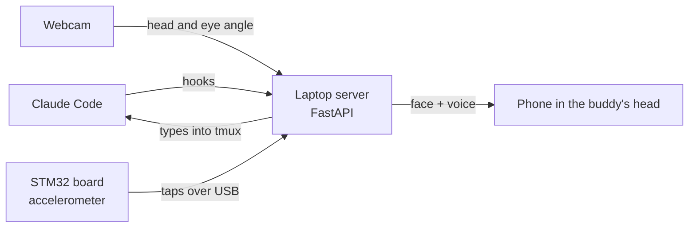

# Claude Buddy

A little Claude mascot that sits on your desk and keeps you honest while Claude Code works.

You give Claude a task, then pick up your phone "just for a second". Claude finishes, and nobody notices.
Claude Buddy notices. It watches you through the laptop's webcam, and when Claude is done
(or needs your permission) while you're scrolling, it gets annoyed, then starts yelling until you
look back at the screen.

## What it does

### Knows what Claude is doing (Claude Code hooks)

- **Claude starts working:** the face switches to "thinking" (eyes look up and sweep left to right,
  like reading).
- **Claude finishes:** happy `^ ^` face and a cheerful voice line ("Okay, I'm done. Come look.").
- **Claude needs permission:** sad face with slanted brows and a voice line ("Quick question, can I
  do this?").
- **Permission answered:** the buddy notices Claude carried on and goes back to working.
- Only the chat started with `claude --settings .claude/buddy-hooks.json` drives the buddy, so other
  Claude chats (like the one in VS Code) don't set it off.

### Watches you (webcam + MediaPipe)

- **Looking at the screen or not:** tracks your head angle and eyes, calibrated during the first 3 s.
  Head down, eyes down or head turned for 2 s counts as "not looking".
- **"Locked in"** means looking at the screen AND Terminal or VS Code in front. Another app in front
  for 2 s also counts as not locked in.
- **Side-eye:** when you start drifting off, the buddy gives you a squinting side-eye before it says
  anything.

### Nags you (voice + face)

- When Claude is done or waiting on you and you're not locked in, it escalates: disappointed lines
  first, then yelling, then a yell every 12 s until you're back.
- **Phone or other app:** if the camera sees you looking at the screen but you're in another app (a
  browser, for example), it uses "another tab" lines instead of "phone" lines.
- **"I wrote 400 lines for you"** only plays if Claude really wrote 100+ lines that turn.
- **Voice timing rules:** no nag line in the first 7 s, it only speaks after 7 s away without a break,
  at least 6 s of silence between lines, and it never talks over itself.
- **Coming back** (looking at the screen with Terminal in front) stops it: "Thank you.", or "Finally,
  thank you." if it yelled, with heart eyes.

### Reacts to taps on its head (STM32 accelerometer)

- **Tap while it's nagging:** you're forgiven. Terminal comes to the front and it says thanks.
- **Tap while another app is in front:** brings Terminal to the front.
- **Tap while locked in, after Claude finished:** "I don't like that answer". It undoes every file
  Claude changed in its last turn, shows a shocked `O O` face, says "Rude! Redoing it." and types a
  prompt asking Claude to find what was wrong and redo it.
- **Tap while Claude is working:** ignored.
- **Knock-knock** (two taps about half a second apart): opens a new Claude Code chat in a new tmux
  window. The old chat keeps running.
- **Unsure double tap:** the phone asks "New chat? Tap me = yes (4)", and a tap within 4 s means yes.
- Most taps show `> <` on the face for a moment.

### The phone face

- A web page at `http://<laptop IP>:8765/face` draws the eyes and plays the voice.
- After one tap on the phone screen, sound plays from the phone. Until then, the laptop plays it.
- A grey dot appears in the corner when the phone can't reach the laptop.

| Face | When |
|---|---|
| normal | idle |
| thinking | Claude is working |
| happy `^ ^` | Claude finished |
| sad | Claude needs permission |
| side-eye | you're starting to drift off |
| `> <` | annoyed or yelling, and most taps |
| shocked `O O` | a tap undid Claude's work |
| hearts | you came back |

### Laptop extras

- **Mood page** at `http://127.0.0.1:8765/`: shows the current state, lets you set it by hand, and
  lets you edit the short text for each mood.
- **Test routes** that fake the hardware: `/slap`, `/knock`, `/maybe` and `/button`.
- **Recalibrate the camera:** `curl -X POST http://127.0.0.1:8765/calibrate`.
- **Safety and privacy:**
  - other devices on the network can only see the face page and download the voice clips;
  - undo never touches files outside the project folder;
  - hook contents (your prompts and Claude's replies) are never logged.

## How it works



- **Claude Code hooks** tell the server when Claude starts, finishes or needs permission.
- **The webcam** uses MediaPipe to tell whether you're looking at the screen or down at your phone.
- **The phone** shows the face in a web page and plays the voice lines.
- **The STM32 board** in the head has an accelerometer that detects taps and knocks.
- **tmux** lets the server type the "redo it" prompt into Claude Code.

## Hardware

- STM32 B-L4S5I-IOT01A Discovery kit (its built-in accelerometer detects the taps)
- Any phone for the face and speaker
- A 3D-printed body, with the head resting on two springs
- A Mac with a webcam

## Running it

You need a Mac, Python 3.10+, tmux and Claude Code.

**1. Start the server**

```sh
cd laptop
python3 -m venv .venv
.venv/bin/pip install -r requirements.txt
.venv/bin/uvicorn buddy.main:app --host 0.0.0.0 --port 8765
```

Look at the screen for the first few seconds so the camera can learn your normal position.
The log prints an address like `http://192.168.x.x:8765/face`.

**2. Open the face on the phone**

Open that address on a phone on the same Wi-Fi (or the phone's hotspot), then tap the screen once
to turn the sound on.

**3. Start Claude Code inside tmux**

```sh
tmux new -s claude
claude --settings .claude/buddy-hooks.json
```

The session must be called `claude`, and `--settings` loads the hooks that drive the buddy.
Now give Claude a task and pick up your phone.

**No hardware?** Fake the taps with curl:

```sh
curl -X POST http://127.0.0.1:8765/slap    # one tap
curl -X POST http://127.0.0.1:8765/knock   # knock twice
curl -X POST http://127.0.0.1:8765/maybe   # unsure double tap
```

Careful: `/slap` can really undo Claude's last changes and type a redo prompt into the `claude`
tmux session.

## Repo layout

| Folder | What's inside |
|---|---|
| `laptop/` | Python server: hooks, camera, voice, face page |
| `firmware/Claude-buddy/` | STM32 firmware (tap detection, serial link) |
| `.claude/buddy-hooks.json` | The Claude Code hooks |

## Credits

Built at a hackathon in November 2026 by Ben Mo, Tyler, Cyprien and Edison.
Voice lines made with [ElevenLabs](https://elevenlabs.io).
