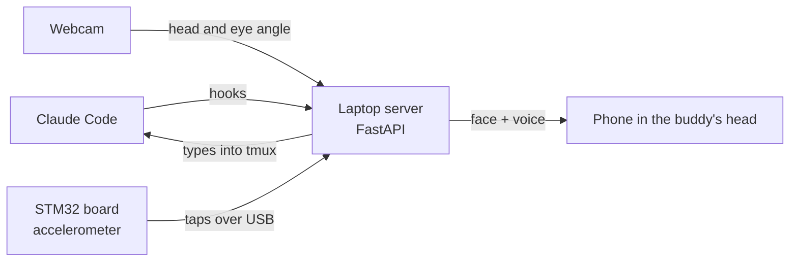

# Claude Buddy

A little Claude mascot that sits on your desk and keeps you honest while Claude Code works.

You give Claude a task, then pick up your phone "just for a second". Claude finishes, and nobody notices.
Claude Buddy notices. It watches you through the laptop's webcam, and when Claude is done
(or needs your permission) while you're scrolling, it gets annoyed, then starts yelling until you
look back at the screen.

## What it does

- **Shows how Claude is doing.** A phone mounted in the buddy's head is its face: normal eyes while
  Claude works, happy `^ ^` when it's done, sad when it needs your permission.
- **Nags you when you're distracted.** If Claude is waiting on you and you're on your phone, the buddy
  gets angry and complains out loud ("Is that phone more interesting than me?"). If you're just in
  another app, it makes a `> <` face. It calms down once you're back in the terminal.
- **Tap its head to react:**
  - one tap after Claude finishes, while you're at the screen: "I don't like that answer". It undoes the files Claude just
    changed and asks Claude to redo it, with an awkward face and a tear;
  - one tap while it's nagging: you're forgiven, and Claude's window comes back to the front;
  - knock twice: opens a new Claude Code chat.

## How it works



- **Claude Code hooks** tell the server when Claude starts, finishes or needs permission.
- **The webcam** uses MediaPipe to tell whether you're looking at the screen or down at your phone.
- **The phone** shows the face in a web page and plays the voice lines.
- **The STM32 board** in the head has an accelerometer that detects taps and knocks.
- **tmux** lets the server type the "redo it" prompt into Claude Code.

## Hardware

- STM32 B-L4S5I-IOT01A Discovery kit (its built-in accelerometer detects the taps)
- Any phone for the face and speaker
- A 3D-printed body, with the head resting on two springs
- A Mac with a webcam

## Running it

You need a Mac, Python 3.10+, tmux and Claude Code.

**1. Start the server**

```sh
cd laptop
python3 -m venv .venv
.venv/bin/pip install -r requirements.txt
.venv/bin/uvicorn buddy.main:app --host 0.0.0.0 --port 8765
```

Look at the screen for the first few seconds so the camera can learn your normal position.
The log prints an address like `http://192.168.x.x:8765/face`.

**2. Open the face on the phone**

Open that address on a phone on the same Wi-Fi (or the phone's hotspot), then tap the screen once
to turn the sound on.

**3. Start Claude Code inside tmux**

```sh
tmux new -s claude
claude --settings .claude/buddy-hooks.json
```

The session must be called `claude`, and `--settings` loads the hooks that drive the buddy.
Now give Claude a task and pick up your phone.

**No hardware?** Fake the taps with curl:

```sh
curl -X POST http://127.0.0.1:8765/slap    # one tap
curl -X POST http://127.0.0.1:8765/knock   # knock twice
```

## Repo layout

| Folder | What's inside |
|---|---|
| `laptop/` | Python server: hooks, camera, voice, face page |
| `firmware/Claude-buddy/` | STM32 firmware (tap detection, serial link) |
| `.claude/buddy-hooks.json` | The Claude Code hooks |

## Credits

Built at a hackathon in November 2026 by Ben Mo, Tyler, Cyprien and Edison.
Voice lines made with [ElevenLabs](https://elevenlabs.io).
